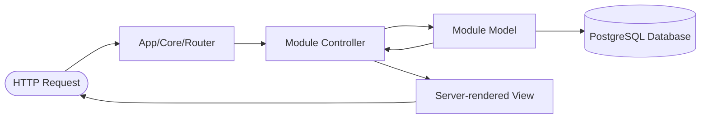

# More Than Blue Appointment & Scheduling System

[](https://www.php.net/)
[](https://www.postgresql.org/)
[](https://getbootstrap.com/)
[](#security-features)

**More Than Blue** is a modular PHP and PostgreSQL appointment management web application. It features a custom modular MVC architecture, custom router, relational database design with prepared queries, conflict-aware appointment scheduling, and strong security practices.

---

## Architecture Overview

The system uses a decoupled **Modular Model-View-Controller (MVC)** design pattern:

```text
/
├── config/              # Environment-based configuration (.env support)
├── core/                # System engine (Router, Database Singleton, Base Controller & Model, Helpers)
├── modules/             # Domain modules & Presentation
│   ├── Layout/          # Master layout wrapper (Responsive Navbar, Flash alerts, Sticky footer)
│   ├── Auth/            # Authentication (Signup, Bcrypt Login, Session lifecycle)
│   ├── User/            # User profile management & Case-insensitive search
│   └── Appointment/     # Booking, Conflict detection, Received & Sent appointment tracking
├── public/              # Web document root (index.php, CSS, JS, secure upload storage)
└── test_security.php    # Automated unit and integration test suite
```

### Request Flow


---

## Security Features

This project incorporates web application security best practices:

- **Password Hashing**: Passwords are stored with PHP's `password_hash()` and checked with `password_verify()`.
- **CSRF Defense**: All state-modifying requests (Profile updates, appointment status changes, bookings, and deletions) require cryptographic CSRF tokens (`_csrf`).
- **Authorization & IDOR Protection**: Direct object reference vulnerabilities are blocked by enforcing strict ownership checks (`receiver_id` or `sender_id`) at the database query layer.
- **Path-Traversal Proof Uploads**: File uploads validate genuine MIME types (`finfo_file`), generate cryptographically random filenames, and enforce directory containment to prevent arbitrary file deletion.
- **SQL Injection Prevention**: All queries run through PDO prepared statements with strict parameter binding.
- **RESTful HTTP Semantics**: Destructive actions and status changes run over `POST` instead of unsafe `GET` requests.

---

## Features

- **Google OAuth 2.0 Login & Signup**: One-click authentication with Google accounts, automatic account creation for new users, and seamless account linking for existing email addresses.
- **Authentication & Profiles**: Secure sign-up, login, and profile editing with image upload validation.
- **Configurable Availability**: Users define their working start/end times and slot durations (15, 30, 45, 60 minutes) in their profile.
- **Public Shareable Booking Link**: Each user has a unique shareable profile link (`/u/{id}`) for direct booking without logging into the search dashboard first.
- **LinkedIn-Style Professional Dossier**: Comprehensive professional profiles with headline, current role & company, base location, about me bio, interactive skills tags, consultation focus areas, and verified social links (LinkedIn, GitHub, Portfolio).
- **Skill-Based & Keyword Discovery**: Search not just by name, but by company, job title, and technical skills (e.g., PostgreSQL, Docker, DevOps) with instant people cards.
- **Interactive Slot Selector**: Dynamic, conflict-aware slot generation via REST API (`/api/appointment/slots`), showing clickable open slots and disabling booked times.
- **Interactive Visual Calendar**: Month calendar view on the dashboard with color-coded status pills, month/year navigation, and instant modal previews.
- **Cal.com Style Meeting Formats**: Selectable session types (⚡ 15m Quick Sync, 💼 30m Consultation, 🚀 60m Deep Dive) and platforms (🎥 Google Meet, 💻 Zoom, 🏢 In-Person, 📞 Phone).
- **Calendar Synchronization**: One-click RFC 5545 `.ICS` export (for Apple Calendar & Outlook) plus direct web links to Google Calendar.
- **Fuzzy User Search**: Partial, case-insensitive user search powered by PostgreSQL `ILIKE` indexing.
- **Received & Sent Panels**: Single-query `JOIN` views for appointments you have received from others and appointments you have sent out.
- **Appointment Status Workflow**: Receivers can approve or deny requests; either party can cancel appointments.

---

## Installation & Setup

### 1. Requirements
- PHP 8.1 or higher (with `pdo_pgsql` extension enabled)
- PostgreSQL 13 or higher

### 2. Clone Repository
```bash
git clone https://github.com/xtianvelasquez/p_002.git
cd p_002
```

### 3. Environment Configuration
Copy the example environment configuration:
```bash
cp .env.example .env
```
Update `.env` with your PostgreSQL database credentials:
```env
DB_HOST=localhost
DB_PORT=5432
DB_NAME=blue
DB_USER=postgres
DB_PASSWORD=your-local-postgres-password
APP_ENV=development
APP_TIMEZONE=Asia/Manila
```

### 4. Database Setup
Run the database importer script against a new or empty database:
```bash
php import_db.php
```
The importer refuses to replace existing application tables by default. `php import_db.php --reset` drops and rebuilds those tables, deleting their data.

For an existing database, review and apply the SQL in `database/migrations/` after resolving any duplicate account identifiers.
The SQL file contains `DROP TABLE` statements. Import it directly only into a new or empty database.

`p_002.sql` is a legacy MariaDB dump. The application uses the PostgreSQL schema in `p_002_postgres.sql`.

### 5. Run the Local Server
Serve from the `public` directory:
```bash
php -S localhost:8000 -t public
```
Visit `http://localhost:8000` in your web browser.

---

## Running Automated Tests

To run the built-in unit and security regression test suite:
```bash
php test_security.php
```
Test cases verify:
1. Bcrypt password verification & wrong password rejection.
2. Partial case-insensitive user search (`ILIKE`).
3. Single-query joined appointment fetching (N+1 query prevention).
4. Time slot conflict detection.
5. Insecure Direct Object Reference (IDOR) access prevention.
6. Session flash message persistence and automatic clearance upon consumption.
7. Master layout encapsulation and unified view rendering.
8. End-to-end user registration and database persistence.
9. Dynamic working-hour slot generation (`generateAvailableSlots`).
10. Automatic detection and flagging of booked time slots.
11. Multi-slot future schedule calculation.

---

## License
MIT License. Developed by [Christian E. Velasquez](https://github.com/xtianvelasquez).
